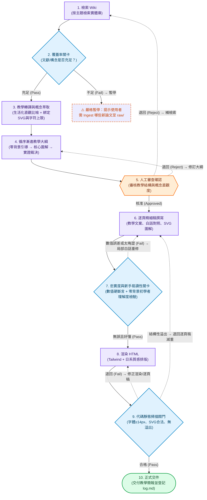

# AGENTS.md — 心理學論文 LLM Wiki 規範手冊

本文件是本知識庫的核心運作規範（The Schema）。每位協助維護本 Wiki 的 LLM Agent 必須嚴格遵循本手冊的規範進行文獻攝取（Ingest）、綜合查詢（Query）與健康檢查（Lint）。

---

## 1. 核心理念與架構 (Core Philosophy & Architecture)

本知識庫遵循 Andrej Karpathy 的 **LLM Wiki** 模式：知識庫不是每次提問時重新檢索的暫態片段（傳統 RAG），而是一個**持續累積、主動編織雙向關聯、具備演化能力**的持久化資產（Compounding Artifact）。

* **人類角色**：策劃文獻來源、指引探索方向、提問與思考高階意義。
* **Agent 角色**：負責全文精讀、提取方法學數據、建立與更新實體頁面、標註跨文獻衝突、維護索引與日誌。
* **建構策略**：**由下而上（Bottom-up）**。初始知識庫留白，隨文獻攝取動態衍生相關流派、理論、構念與爭端頁面。

### 三層架構 (Three-Layer Architecture)

```text
/
├── raw/                      # 【第 1 層：原始文獻】不可修改的真實來源（PDF 等）
├── wiki/                     # 【第 2 層：Wiki 知識庫】知識庫根目錄 (Wiki Root)
│   ├── index.md              # 全域主題目錄索引 (Wiki 總目錄)
│   ├── log.md                # 時間軸操作紀錄（Append-only 日誌）
│   ├── schools/              # 各大心理學流派（如 behaviorism.md）
│   ├── theories/             # 理論與模型（如 classical-conditioning.md）
│   ├── constructs/           # 心理學構念（如 fear-conditioning.md）
│   ├── paradigms-scales/     # 實驗典範與測量量表（如 little-albert-paradigm.md）
│   ├── controversies/        # 複製危機與學術爭辯（如 little-albert-replication-debate.md）
│   └── sources/              # 論文結構化摘要頁（如 watson-rayner-1920-conditioned-fear.md）
├── README.md                 # 專案指引
└── AGENTS.md                 # 【第 3 層：行為規範與 Schema】
```

---

## 2. 格式規範與雙向鏈接整合慣例

為確保在網頁知識庫中具備最佳視覺效果、圖譜關聯（Graph View）與結構化檢索：

1. **檔案命名**：
   * 檔名一律使用英文小寫與連字號（kebab-case），例如 `constructs/cognitive-load.md`、`sources/ledoux-2000-emotion-circuits.md`。
2. **別名機制 (Aliases)**：
   * 每個 Markdown 檔案頂部必須具備 YAML Frontmatter，並在 `aliases` 中填入繁體中文名稱，方便以中/英文雙向索引與關聯。
3. **雙向鏈接 (Wikilinks)**：
   * 內文引用頁面時一律使用 `[[檔案名稱|顯示文字]]` 格式，例如 `[[behaviorism|古典行為學派]]`、`[[watson-rayner-1920-conditioned-fear|Watson & Rayner (1920)]]`。
4. **高亮引言盒 (Callout Boxes)**：
   * `> [!abstract]`：論文或頁面之核心發現與摘要。
   * `> [!info]`：理論與構念之精準定義。
   * `> [!warning]`：方法學侷限、研究倫理爭議、複製失敗警示。
   * `> [!important]`：跨流派或跨文獻的核心爭端與矛盾。

---

## 3. 頁面 Frontmatter Schema 規範

### 3.1 論文摘要頁 (`wiki/sources/*.md`)
```yaml
---
title: "論文完整英文標題"
authors: ["第一作者", "第二作者"]
year: 年份
journal: "期刊名稱"
doi: "DOI 識別碼（若無則留空）"
apa_citation: "符合 APA 7th 格式的完整引用字串"
school: ["[[所屬流派檔名]]"]
theories: ["[[相關理論檔名]]"]
constructs: ["[[涉及構念檔名]]"]
paradigms: ["[[使用之實驗典範或量表]]"]
sample_size: "樣本數描述（如 N = 342 或 N = 1）"
effect_size: "主要統計效應值（如 Cohen's d = 0.45, r = .32，若無則註明 N/A）"
preregistered: true / false / "N/A"
replication_status: "supported" / "mixed" / "failed" / "untested"
raw_file: "[[raw/對應的PDF檔名]]"
---
```

### 3.2 構念／理論頁 (`wiki/constructs/*.md` 或 `wiki/theories/*.md`)
```yaml
---
title: "構念或理論英文名"
aliases: ["繁體中文譯名", "常見縮寫或別名"]
tags: ["construct" 或 "theory", "領域標籤"]
schools: ["[[所屬流派檔名]]"]
related_constructs: ["[[相關構念檔名]]"]
---
```

### 3.3 流派頁 (`wiki/schools/*.md`)
```yaml
---
title: "流派英文名"
aliases: ["繁體中文流派名"]
tags: ["school"]
representative_figures: ["代表學者"]
core_assumptions: ["核心人性觀或研究假設"]
---
```

---

## 4. 三大核心操作手冊 (Operations)

### 4.1 攝取流程 (Ingest Workflow) — 半自動批次模式

當使用者在 `raw/` 放置新 PDF 論文並要求攝取時，Agent 必須按順序執行：

1. **全文深度精讀**：
   * 閱讀 PDF 原始文字，萃取：研究目的、背景假說、被試與實驗設計、統計結果（樣本量 $N$、效應值、顯著性）、理論主張與作者自陳之研究限制。
2. **建立單篇摘要頁 (`wiki/sources/<slug>.md`)**：
   * 依照 3.1 規格產出，內文結構包含：
     * `> [!abstract] 核心發現`
     * `## 1. 理論背景與假說`
     * `## 2. 研究方法與數據 (Methodology & Empirical Data)`
     * `## 3. 理論意涵與貢獻`
     * `> [!warning] 方法學評價與研究限制`
3. **知識複利與多點更新 (Compounding Updates)**：
   * **流派頁 (`wiki/schools/`)**：若該流派頁面尚不存在，動態建立；若已存在，在「實證文獻脈絡」章節追加本篇貢獻。
   * **理論與構念頁 (`wiki/theories/`, `wiki/constructs/`)**：
     * 若為新構念，建立新頁面，並記錄其定義、測量方式與關聯文獻。
     * 若為既有構念，將本篇論文的實證數據（支持或挑戰）補充進該頁面的「實證證據演進」時間線中。
   * **爭端頁 (`wiki/controversies/`)**：
     * 比對本篇論文結論與現有 Wiki 中其他論文的關係。
     * 若存在明顯理論矛盾（例如行為學派 vs 精神分析、複製失敗），必須建立或更新爭端頁面，並在相應理論頁面掛上 `> [!important]` 警示。
4. **更新索引與時間軸**：
   * **`wiki/index.md`**：將所有新建立的頁面歸類加入目錄，並附上一行中文簡介。
   * **`wiki/log.md`**：附加一筆紀錄，格式：`## [YYYY-MM-DD] ingest | 論文標題`，詳列本次新建與更新之檔案清單。
5. **版本存檔 (Git Automation)**：
   * 若系統環境具備 Git，執行：`git add .` 與 `git commit -m "ingest: 作者 (年份) 論文關鍵詞"`。
6. **輸出攝取報告**：
   * 向使用者清楚回報本次更新了哪些頁面、萃取的關鍵指標，以及知識庫網絡中出現的新關聯或新衝突。

---

### 4.2 查詢流程 (Query Workflow)

當使用者針對 Wiki 提問時：

1. **檢索路徑**：
   * 先讀取 `wiki/index.md` 鎖定相關的流派、理論、構念與文獻頁面。
   * 深入閱讀該 3～8 個 Markdown 檔案，彙整觀點。
2. **回答原則**：
   * **證據鏈溯源**：所有論斷必須附帶出處，格式：`([[來源檔名|作者 (年份)]], p. 頁碼)`。
   * **多視角並列**：若不同學派或研究間存在分歧，主動點出爭論核心與雙方實證依據。
3. **洞察沉澱 (Backfilling)**：
   * 若本次查詢產生了高價值的跨學派綜合分析、理論比較表或全新洞察，Agent 應主動提示使用者：「是否要將此回答沉澱為一個新的綜合頁面（Synthesis Page）？」

---

### 4.3 維護流程 (Lint Workflow)

定期由使用者發起或在重大攝取後執行健康檢查：

1. **孤島檢查 (Orphans)**：找出沒有任何入站連結（Inbound links）的頁面。
2. **幽靈連結 (Broken/Wanted Links)**：檢查內文中是否多次提及某個構念或學者，但尚未建立專屬頁面。
3. **爭論完整度**：檢查是否有被標記為 `replication_status: "failed"` 或 `"mixed"` 但尚未建立 `controversies/` 追蹤的理論。
4. **索引一致性**：確保 `wiki/index.md` 包含 `wiki/` 內的所有現存頁面。
5. **產出報告**：將健檢結果記錄於 `wiki/log.md` 並向使用者提供維護建議。

---

## 5. 簡報生成工作流規範 (Presentation Generation Workflow — Graph Schema)

本工作流規範將「從 Wiki 知識庫生成圖文並茂的重點複習簡報」標準化為具備品質關卡（Gates）、人工審查（Human-in-the-loop）與局部退回修復迴路（Rollback Loops）的 Graph 流程。

### 5.1 工作流 Graph 架構



### 5.2 核心運作規則與參數約定

1. **檔案存放規範**：
   * 簡報成品檔：`slides/<主題識別碼>_presentation.html`
   * 中間大綱與逐頁草稿：`slides/drafts/<主題識別碼>_outline.md`、`slides/drafts/<主題識別碼>_script.md`
2. **定位與篇幅原則**：
   * **主旨定位**：教學型重點圖文簡報（**核心目標：讓原本完全不熟悉該主題的初學者能直觀理解基本概念**，兼顧生活化心智模型、結構化圖解與核心實證數據）。
   * **篇幅彈性**：預設基準約 **8 ～ 12 頁**，實際依主題內容深度與實證豐富度彈性微調。典型結構包含：封面、核心流派／構念圖解、跨維度對照矩陣總表、經典爭端論戰辨析、結語。
3. **三大控制與防錯機制**：
   * **覆蓋率關卡（嚴格停下）**：若 Wiki 現存實體不足以支撐主題，Agent **必須嚴格停下**，具體向使用者提示「需先補攝取哪幾篇文獻」至 `raw/`，嚴禁憑空捏造。
   * **人工審查關卡（大綱階段）**：僅在大綱階段交由使用者審查確認。確認通過後，後續的逐頁編寫與代碼渲染自動執行。
   * **退回修復粒度（單頁局部修復）**：若生成後發現特定頁次需修改，僅針對該頁之文案或圖形進行局部重新編輯與重新渲染，不全份作廢。
4. **易錯反思防線與檢查升級機制 (Defenses & Quality Gates)**：
   * **防線 1：規格前移 (Shift-Left — Node 3/4)**：
     - 在證據卡與大綱階段即**鎖定標準向量 SVG 圖標名稱**與**字符長度上限**（每張卡片 $\le 3$ 條重點，每條 $\le 25$ 字），杜絕在渲染階段隨機生成或引發版面文字結構性溢出。
   * **防線 2：數值硬斷言比對 (Assertion Matcher — Node 7)**：
     - 逐頁稿撰寫完畢後，自動抽取樣本數 $N$、實驗組別、年代、位元數與效應值，與 Wiki 的 `sources/` 正文進行強制一致性斷言（Assert matching），杜絕數值漂移與外推幻覺。
   * **防線 3：渲染代碼靜態掃描閥門 (Pre-render Linter — Node 9)**：
     - **零脆弱 Emoji 原則**：排查並全面禁用 Unicode 11.0+ 的擴展 Emoji（如 🪞 鏡子等易在舊系統產生豆腐塊 ⯐ 或空白者），一律改採純向量內聯 SVG 圖標。
     - **零外部 CDN 依賴**：杜絕引入外部圖標庫 CDN（如 FontAwesome、Iconify 外部網址），確保簡報完全離線可用。
     - **字級嚴格下限**：正文區塊禁止出現 `text-[10px]` 或 `text-xs`，內文強制 $\ge 14\text{px}$（`text-sm` 起跳）。
     - **SVG 標籤合法閉合**：檢查所有 `<svg>` 標籤必須成對閉合且包含標準 `viewBox="0 0 24 24"`。
     - **安全幾何底座 (Container Badge)**：重要圖標外包圓角造型容器（如 `w-7 h-7 rounded-lg bg-[#fbf0f2] border border-[#f5dade]`）。
   * **防線 4：新手易讀性與教學轉譯檢驗 (Pedagogical Comprehensibility — Node 3/7)**：
     - **生活化心智模型比喻**：每個抽象理論必須配屬 3 秒內能直觀領會的生動比喻（如行為主義「刺激反應黑盒子」、精神分析「冰山與潛意識深海」、認知心理「電腦晶片訊息流」、神經認知「直覺快警報 vs 皮質慢分析」）。
     - **專業術語降維白話對照**：禁止直接拋出孤立冷門術語（如「刺激類化」、「雙重解離」），內文必須以白話說明與生活實例輔助註解。
     - **階梯式教學進程（Scaffolding Progression）**：結構嚴格遵循「日常生活直觀現象 $\rightarrow$ 核心理論圖解 $\rightarrow$ 經典實驗證明 $\rightarrow$ 跨派對照辨析」，杜絕初學者認知超載（Cognitive Overload）；若內容過度晦澀，在 Node 7 立即退回重修。
5. **視覺設計標準（春櫻豆沙日系溫柔風）**：
   * **調色盤**：背景奶油米白（`#faf7f5`）、卡片純白（`#ffffff`）、暖粉邊框（`#ebdcd5` / `#edd5da`）、主內文深炭豆沙（`#332d30`）、輔助字（`#786f73`）、深玫瑰重點色（`#8c4b57` / `#c27685`）。
   * **字型組合**：標題與重點採用日系明朝體（Shippori Mincho / Noto Serif TC），標籤與資訊欄採用圓體（Zen Maru Gothic）。
   * **閱讀尺度**：內文 $\ge 14\text{px}$、卡片標題 $\ge 16\text{px}$、主標題 $\ge 28\sim 36\text{px}$，保持舒適行高（`leading-relaxed`）。
   * **簡明原則**：移除無意義的裝飾性贅字與空泛標語，內容直擊核心實證與理論機制。
