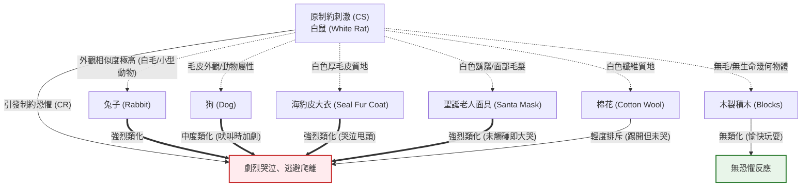

# 刺激類化 (Stimulus Generalization)

> [!info] 構念定義
> 刺激類化是指個體對某一特定制約刺激（CS）建立制約反應後，面對其他在物理屬性、外觀特徵或語意概念上與原刺激相似的新刺激時，不需額外經過制約學習，亦能引發相同或相似程度制約反應的現象。通常新刺激與原 CS 越相似，誘發的反應強度越高（類化梯度 Generalization Gradient）。

---

## 1. 經典實證：小阿爾伯特的情緒轉移 (Watson & Rayner, 1920)

在 [[watson-rayner-1920-conditioned-fear|Watson & Rayner (1920)]] 實驗中，研究者在 Albert 身上建立了對「白鼠」的恐懼制約後，以一系列全新刺激測試其「轉移（Transfer）」反應：

---

## 2. 臨床與心理病理學意涵 (Clinical Significance)

* **恐懼症的擴散機制**：
  * 臨床上許多特定恐懼症（Specific Phobias）患者所畏懼的對象往往不只是最初創傷事件中的單一物體，而是透過刺激類化擴散至整個範疇（例如：被特定狂犬咬傷後，類化為對所有犬類、毛茸茸布偶甚至犬吠錄音的普遍性恐慌）。
* **與環境特徵的分離**：
  * Albert 對積木毫無恐懼，證實刺激類化是具備**特徵選擇性（Feature-selective）**的，並非單純對整個實驗室或環境的全面性焦慮。
