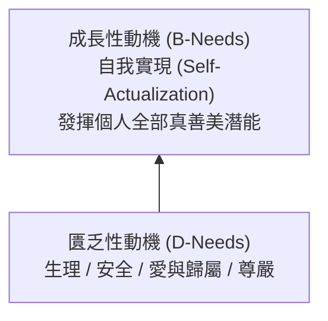

# 人本主義心理學派 (Humanistic Psychology)

> [!info] 流派概述
> 人本主義心理學於 20 世紀中葉崛起，被譽為繼精神分析（第一勢力）與行為主義（第二勢力）之後的「**心理學第三勢力（The Third Force）**」。該學派反對將人視為受動物本能驅使的受害者（批判精神分析），亦反對將人視為受環境機械制約的自動機（批判行為主義），極力倡導人性尊嚴與積極正向潛能。

---

## 1. 核心理論支柱 (Theoretical Pillars)

1. **需求階層與相對優勢 (Hierarchy of Needs)**：
   * [[hierarchy-of-needs|需求階層理論]]：從底層生理、安全、愛、自尊，逐層晉級至頂層的 [[self-actualization|自我實現]]。
2. **自我實現傾向 (Actualizing Tendency)**：
   * 借鑒 Kurt Goldstein 的有機體理論，認為個體有將自身全部潛力轉化為現實的強大衝動（「一個人能成為什麼，他就必須成為什麼」）。
3. **當事人中心與無條件正向關懷 (Person-Centered)**：
   * Carl Rogers 提倡真誠一致、共情理解與無條件接納，促成個體自我概念與真實經驗的整合。

---

## 2. 實證文獻脈絡 (Empirical Context)

| 年份 | 代表文獻 / 學者 | 核心實證發現 | 影響與地位 |
| :--- | :--- | :--- | :--- |
| **1943** | [[maslow-1943-human-motivation\|Maslow (1943)]] | 提出人類動機的五大基本需求階層與相對優勢性（Relative Prepotency），探討階層例外與挫折耐受力。 | 人本主義心理學在人類動機領域的開山奠基之作。 |

---

## 3. 學派衝突與對抗論點 (School Conflicts)

* **人本主義 vs. [[behaviorism|行為學派]]**：
  * **批判點**：Maslow 強烈反對以白鼠飢餓或白鴿啄食為範例來推導人類行為，批評其為「偽簡約（Pseudo-simplicity）」，忽視了人類獨特的高階目標與價值追求。
* **人本主義 vs. [[psychoanalysis|精神分析學派]]**：
  * **批判點**：批評佛洛伊德將人類動機完全侷限於受壓抑的性本能與病理創傷，指出研究心靈健全的人類更能反映人性的真實面貌。
