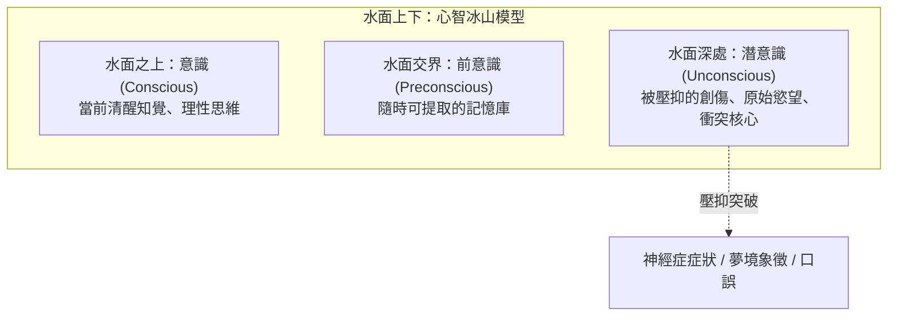

# 精神分析學派 (Psychoanalysis)

> [!info] 流派概述
> 精神分析學派由奧地利精神醫學家 Sigmund Freud 於 19 世紀末創立。該學派革命性地將心理學探索的視野從清醒意識推向深層「潛意識（Unconscious）」，強調內在心理動力、本能衝突、防衛歷程以及童年經驗對人格結構的深遠塑造。

---

## 1. 核心理論支柱 (Theoretical Pillars)

1. **意識三層次與心理結構**：
   * 意識（Conscious）、前意識（Preconscious）、潛意識（Unconscious）。
   * 本我（Id，遵循享樂原則）、自我（Ego，遵循現實原則）、超我（Superego，遵循道德原則）。
2. **壓抑與心理防衛機制 (Defense Mechanisms)**：
   * 當衝突過於痛苦，自我發動「[[repression|壓抑]]」封鎖記憶；當壓抑失效，則藉由身體化轉換（Conversion）、置換或投影形成症狀。
3. **性動力與發展階段**：
   * 心理性慾能量（Libido）自嬰兒期即存在（[[infantile-sexuality|幼兒性慾]]），經歷口腔期、肛門期、性器期（伊底帕斯情結），並可能發生固著（Fixation）與退行（Regression）。
4. **精神分析治療核心**：
   * [[talking-cure-catharsis|談話療法與情緒宣洩]]、自由聯想、夢的解析、[[transference|移情作用]] 之解析與修通。

---

## 2. 實證文獻脈絡 (Empirical Context)

| 年份 | 代表文獻 / 學者 | 核心實證發現 | 影響與地位 |
| :--- | :--- | :--- | :--- |
| **1910** | [[freud-1910-psychoanalysis-origin\|Freud (1910)]] | 發表克拉克大學五場著名演講，總結 Anna O. 案例、壓抑理論、夢的解析、幼兒性慾與移情作用。 | 精神分析正式登陸美國與國際學術舞台的歷史里程碑。 |

---

## 3. 學派衝突與對抗論點 (School Conflicts)

* **精神分析 vs. [[behaviorism|行為主義學派]]**：
  * **病因爭議**：[[watson-rayner-1920-conditioned-fear|Watson & Rayner (1920)]] 質疑佛洛伊德將恐懼症全數歸結於童年性壓抑，以小阿爾伯特實驗證明環境制約刺激（S-R）才是恐懼症的直接成因。
* **精神分析 vs. [[humanistic-psychology|人本主義學派]]**：
  * [[maslow-1943-human-motivation|Maslow (1943)]] 批評精神分析「只研究病態個體與本能衝動」，忽略了健康人類追求潛能發揮的自我實現傾向。
* **科學哲學質疑**：
  * Karl Popper 批評精神分析「無法被證偽（Unfalsifiable）」；任何臨床反例皆能被精神分析以防衛機制予以事後解釋。
