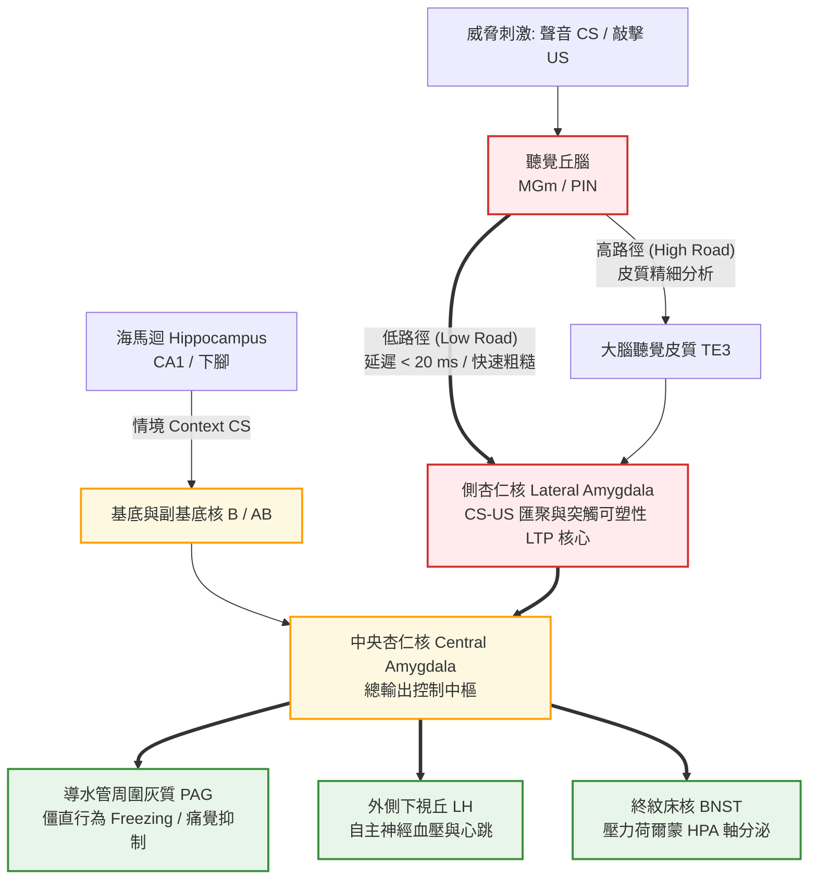

# Emotion Circuits in the Brain (LeDoux, 2000)

> [!abstract] 核心發現
> Joseph LeDoux 突破了傳統模糊的「邊緣系統（Limbic System）」概念，透過巴夫洛夫恐懼制約典範，精確解構了大腦情緒學習與記憶的神經解剖與分子機制：
> 1. **感覺介面 (Sensory Interface)**：側杏仁核（Lateral Amygdala, LA）是聽覺與各類感覺刺激進入杏仁核的核心入口，也是 CS（制約刺激）與 US（嫌惡刺激）資訊匯聚與突觸可塑性發生的關鍵中樞。
> 2. **雙路徑傳導 (Dual Pathways)**：
>    * **低路徑 (Low Road, 丘腦 $\rightarrow$ 側杏仁核)**：反應延遲極短（$<20\text{ ms}$），提供快速、粗糙的無意識危機警報。
>    * **高路徑 (High Road, 丘腦 $\rightarrow$ 聽覺皮質 $\rightarrow$ 側杏仁核)**：處理複雜、精細的情境刺激表徵。
> 3. **輸出中樞 (Output Central)**：中央杏仁核（Central Amygdala, CE）負責統籌控制防衛行為（導水管周圍灰質 PAG $\rightarrow$ 僵直 Freezing）、自主神經亢奮（外側下視丘 LH $\rightarrow$ 血壓上升）及壓力荷爾蒙分泌（終紋床核 BNST $\rightarrow$ 腎上腺皮質軸 HPA）。
> 4. **情境恐懼與雙重解離**：情境恐懼需海馬迴參與。人類雙重解離研究（Bechara et al., 1995）證實杏仁核損毀喪失內隱情緒制約，但外顯記憶完好；海馬迴損毀則喪失外顯記憶但情緒制約完好。

---

## 1. 理論背景與對「邊緣系統」的典範批判

長達半世紀，神經科學界慣用 MacLean 的「邊緣系統（Limbic System / 內臟腦）」來籠統解釋情緒。LeDoux 指出其理論嚴重瑕疵：
* **邊界模糊無法定義**：歷經 50 年爭論，沒有任何一致標準界定哪些腦區屬於邊緣系統。
* **認知與情緒切割崩解**：邊緣系統的核心——海馬迴（Hippocampus），在 Scoville & Milner (1957) 對病患 H.M. 的研究中被證實主要掌管純認知性的長期外顯記憶，而非原始情緒。
* **情緒的客觀操作化**：LeDoux 主張擺脫主觀「感覺經驗」的糾纏，將情緒定義為大腦「偵測威脅並做出防衛反應的客觀資訊處理系統」，而巴夫洛夫恐懼制約正是解開該迴路的最佳科學鑰匙。

---

## 2. 恐懼神經解剖學迴路 (Neuroanatomy of Conditioned Fear)

---

## 3. 細胞與分子層級之長時程增益 (LTP)

* 恐懼制約在側杏仁核（LA）誘發突觸可塑性，其機制類似海馬迴之長時程增益（LTP）。
* **受體途徑**：丘腦-杏仁核路徑仰賴 L-型電壓閘門鈣離子通道；皮質-杏仁核路徑則仰賴 NMDA 受體。
* **分子串聯**：細胞內鈣離子湧入 $\rightarrow$ 活化 CaMKII、PKA、MAP 激酶 $\rightarrow$ 促發 CREB 轉錄因子 $\rightarrow$ 誘發蛋白質合成。注射蛋白質合成抑制劑（Anisomycin）會精確阻斷長期記憶鞏固，但不影響短期記憶。

---

## 4. 理論傳承與跨文獻連結 (Compounding Insights)

* **行為主義的現代生理還原**：
  * [[watson-rayner-1920-conditioned-fear|Watson & Rayner (1920)]] 在 80 年前於嬰兒身上觀察到的「外在行為制約」，在 LeDoux 手中獲得了精確的神經迴路解析。Watson 所稱的「黑盒子反射」，本質上就是丘腦-側杏仁核-中央杏仁核的神經突觸強化。
* **消退與臨床恐懼症機制**：
  * 內側前額葉皮質（mPFC）對杏仁核具有下行抑制功能。mPFC 損傷的大鼠其恐懼制約變得「極難消退」（Morgan et al., 1993），這直接為創傷後壓力症候群（PTSD）與難治型恐懼症提供了神經生物學模型。

---

> [!important] 核心學術爭端：儲存中樞 vs. 調節器？
> Cahill & McGaugh (1998) 認為杏仁核僅僅是「調節其他腦區記憶鞏固的輔助器官」，真實記憶存於海馬迴與皮質。LeDoux 與 Fanselow (1999) 則以嚴謹實驗反駁：利用毒蕈蕈醇（Muscimol）在學習期間暫時阻斷杏仁核神經活動，制約學習便完全無法發生，證實**側杏仁核本身即是恐懼記憶獲得與儲存的不可或缺神經基質**。詳見 [[amygdala-storage-vs-modulation|杏仁核記憶儲存 vs 調節爭端]]。
