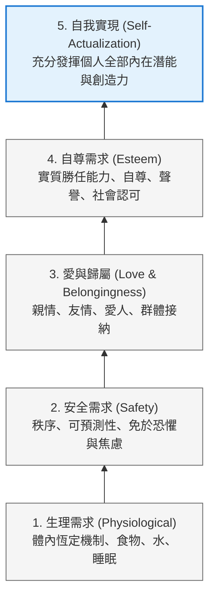

# A Theory of Human Motivation (Maslow, 1943)

> [!abstract] 核心發現
> Abraham Maslow 提出了開創性的人類動機架構，強調有機體的整體性與目標導向性。人類的基本需求並非分散無序，而是依據 **「相對優勢性（Hierarchy of Relative Prepotency）」** 依序排列為五大層級：
> 1. **生理需求 (Physiological)**
> 2. **安全需求 (Safety)**
> 3. **愛與歸屬需求 (Love & Belongingness)**
> 4. **自尊需求 (Esteem)**
> 5. **自我實現需求 (Self-Actualization)**
> 
> 當較具優勢（較低層級）的需求獲得相對滿足後，較高層次的需求才會浮現成為主導行為的核心動力；一個獲得滿足的需求便不再是行為的驅動力。

---

## 1. 理論背景與對兩大主流的批判

1940 年代心理學充斥著兩大陣營：**古典行為主義**（以白鼠飢餓或電擊等動物生理驅力為模型）與**佛洛伊德精神分析**（以病態神經症與潛意識性壓抑為模型）。Maslow 認為這兩種取向皆扭曲了真實的人性：
* **批判動物中心論**：反對將白鼠的局部生理驅力（如胃部收縮的飢餓）套用至整體人類；動機理論必須是以「人為中心（Human-centered）」的。
* **批判病理中心論**：心理學不應只研究心靈受挫的病人，更應研究健康者追求自我實現的積極潛能。
* **整體動力學（General-Dynamic Theory）**：融合 James/Dewey 的功能學派、Wertheimer/Goldstein 的格式塔整體論，以及 Freud/Adler 的動力學。

---

## 2. 五大基本需求階層與特徵

### 2.1 需求層級體系

### 2.2 階層特徵的重要細緻修正（常見誤解釐清）
* **非全有全無 (Not All-or-None)**：一般人誤以為低層需求必須 100% 滿足，高層才會出現。Maslow 明確提出：階層是以「遞減滿足百分比」並存的（例如一般健康成人大約：85% 生理、70% 安全、50% 愛、40% 自尊、10% 自我實現）。
* **階層反轉例外 (Reversals)**：
  1. *自尊重於愛*：某些個體為了獲取愛，轉而先以強勢、進取的自尊外表作手段。
  2. *殉道者與理想高於一切*：基於高尚社會價值或信念，個體甘願犧牲安全甚至生理生命。
  3. *天賦創造者*：某些藝術家與科學家即使身處貧困剝奪環境，創造與自我實現驅力依然凌駕一切。
* **童年充分滿足所產生的「挫折耐受力」**：幼年期基本需求獲得安全與關愛的孩子，成年後具備強大的挫折耐受性（Frustration Tolerance）。

---

## 3. 理論意涵與貢獻

* 奠定了「人本主義心理學（第三勢力）」的核心理論基石。
* 推動了後續正向心理學（Positive Psychology）與內在動機（自我決定論 SDT）的發展。

---

> [!warning] 實證檢驗與跨文化爭端
> * **測量與操作型定義困難**：「自我實現」概念在實證研究中不易被量化與客觀測量。
> * **跨文化通用性挑戰**：集體主義文化（如東亞社會）常發現「群體歸屬與社會連結」優先於「個人的自尊與自我實現」，挑戰了階層順序的絕對普世性。詳見 [[hierarchy-universality-debate|需求階層普遍性與文化差異爭辯]]。
