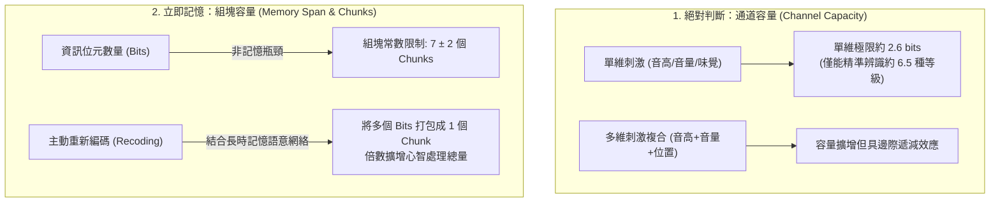

# The Magical Number Seven, Plus or Minus Two (Miller, 1956)

> [!abstract] 核心發現
> George Miller 將資訊理論（Information Theory）引進認知心理學，揭示了人類認知架構中兩項截然不同但極度關鍵的容量瓶頸：
> 1. **絕對判斷之通道容量 (Channel Capacity)**：人類對單一維度刺激（音高、響度、味道、線段長度）的絕對辨識能力上限為 **$2.6\text{ bits}$（約 5 到 9 個類別，平均 6.5 個）**。增加刺激的維度能提升容量，但增長幅度遞減。
> 2. **立即記憶廣度 (Immediate Memory Span)**：短期記憶容量受到 **組塊數量（Chunks）** 而非資訊位元（Bits）的嚴格限制，恆常維持在 **$7 \pm 2$ 個組塊**。
> 3. **重新編碼（Recoding / Chunking）**：人類透過將分散的刺激組合成高層次、有意義的結構（如語詞、代碼），能大幅克服短期記憶的容量瓶頸。

---

## 1. 理論背景與資訊理論引入

1950 年代正值心理學從「行為主義 S-R 黑盒子」走向「認知革命」的轉折點。Miller 借鑒 Shannon 的資訊理論：
* 將人類觀察者視為一個**通訊通道（Communication Channel）**。
* 輸入刺激的變異（Variance）代表輸入資訊量；輸入與輸出反應的共變異（Covariance）即為**傳遞資訊量（Transmitted Information）**。
* 隨輸入刺激數量增加，傳遞資訊量逐漸達到的漸近極限值，即為**通道容量（Channel Capacity）**。

---

## 2. 實證數據與核心分析 (Empirical Data)

### 2.1 單維刺激的絕對判斷通道容量
Miller 統整了多項經典心理物理學實驗數據：
* **音高 (Pitch)**（Pollack）：極限約為 **$2.5\text{ bits}$**（約 6 個無法混淆的音高）。
* **音量 (Loudness)**（Garner）：極限約為 **$2.3\text{ bits}$**（約 5 個等級）。
* **味覺濃度 (Taste Intensity)**（Beebe-Center et al.）：極限約為 **$1.9\text{ bits}$**（約 4 種鹽水濃度）。
* **視覺位置 (Visual Position)**（Hake & Garner）：極限約為 **$3.25\text{ bits}$**（10～15 個位置）。
* **整體單維均值**：$\mu = 2.6\text{ bits}, \sigma = 0.6\text{ bits}$。換算為可辨識類別數約為 $6.5$ 類（$4$ 到 $10$ 之間）。

### 2.2 關鍵理論突破：Bits vs. Chunks 的分野
當時學界普遍誤以為「絕對判斷容量」與「立即記憶廣度」（均約為 7）源自同一神經生理瓶頸。Miller 透過嚴密比對 Hayes (1952) 與 Pollack (1953) 的記憶廣度實驗予以推翻：
* 若短期記憶受限於「資訊量（Bits）」，則二進位數字（1 bit/item）應能記住 23 個，單音節單字（10 bits/item）只能記住 2~3 個。
* **實驗事實**：受試者能記住 9 個二進位數字、7 個十進位數字、5 個英文單字。
* **結論**：**立即記憶的上限不是 bits，而是 chunks！**

### 2.3 重新編碼（Recoding）實驗
* Sidney Smith (1954) 實驗：將 18 個二進位數字（010001...）以 3:1 規則重新編碼為 6 個八進位數字（0~7）。
* 受試者經過短暫訓練後，記憶廣度由 9 個二進位數字暴增至 **40 個二進位數字**！
* 語言（Language）正是人類演化中最極致的重新編碼工具。

---

## 3. 理論意涵與貢獻 (Cognitive Revolution)

* 正式敲響了古典行為主義黑盒子論調的喪鐘，確立了人類心智為**主動重新編碼、處理與儲存資訊的系統**。
* 奠定了後續短期記憶、工作記憶（Baddeley Working Memory）與注意力心理學的研究典範。

---

> [!warning] 後續爭議與重複檢驗修正
> * **Cowan (2001) 的 4±1 修正**：現代認知心理學指出，Miller 的 $7\pm 2$ 包含了語音複誦（Subvocal Rehearsal）與長時記憶輔助。在嚴格排除複誦與組塊策略的純純粹短期記憶容量，其實只有 **$4 \pm 1$ 個組塊**。詳見 [[chunking-capacity-cowan-debate|短期記憶容量 7±2 vs. 4±1 爭辯]]。
