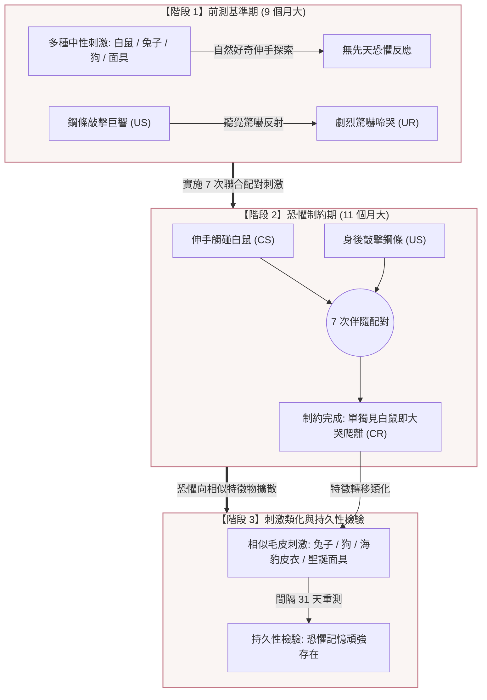

# Conditioned Emotional Reactions (Watson & Rayner, 1920)

> [!abstract] 核心發現
> 嬰兒先天的原始情緒反應極為有限（僅觀察到恐懼、憤怒與愛）。透過將先天無恐懼反應的中性刺激（白鼠 CS）與引發強烈驚嚇的非制約刺激（敲擊鋼條之巨響 US）進行 7 次聯合配對，成功在 11 個月大的嬰兒 Albert 身上建立了對白鼠的恐懼制約反應；此恐懼反應進一步類化至其他帶有毛皮特徵的刺激（兔子、狗、海豹皮大衣、棉花、聖誕老人面具），並在相隔 31 天後依然持續存在。

---

## 1. 理論背景與假說 (Theoretical Background & Hypotheses)

在 20 世紀初，心理學正面臨內省主義（Introspectionism）與精神分析（Psychoanalysis）的思潮主導。John B. Watson 主張心理學應轉型為客觀研究「外顯可觀察行為」的自然科學。

Watson 與 Morgan 先前提出假說：成人在面對環境刺激時所展現的複雜情緒，並非來自遺傳本能或潛意識性慾衝突，而是由嬰兒期少數基本情緒經由**制約反射歷程（Conditioned Reflex Factors）**擴展組合而來。本研究提出四項核心實驗問題：
1. **制約獲得 (Acquisition)**：能否透過將動物（白鼠）與敲擊鋼條巨響配對，人為建立恐懼情緒？
2. **刺激轉移 (Transfer / Generalization)**：若恐懼建立，是否會類化擴展至其他動物或外觀相似之無生命物體？
3. **時間持久性 (Temporal Stability)**：此制約情緒能維持多久？是否會隨時間自然消退？
4. **去制約方法 (Extinction / Detachment)**：若未自然消退，實驗室可用何種技術予以消除？

---

## 2. 研究方法與數據 (Methodology & Empirical Data)

### 2.1 被試特徵 (Participant)
* **被試**：Albert B.，9 個月大健康男嬰，自幼在 Harriet Lane 殘疾兒童之家由擔任乳母的母親撫養。
* **入選理由**：發育健全良好（9 個月體重達 21 磅），性格沉穩（stolid and unemotional），極少哭泣，研究者認為對其進行實驗「造成的傷害相對微小」。

### 2.2 實驗進程與關鍵時程數據
* **前測階段（約 9 個月大）**：
  * *情緒基準測試*：依序呈現白鼠、兔子、狗、猴子、帶毛與無毛面具、棉花、燃燒紙張等。Albert 展現抓取探索反應，**完全未出現任何恐懼**。
  * *聽覺刺激測試 (8m 26d)*：在 Albert 身後以鐵鎚重擊長 4 英尺、直徑 0.75 英寸的懸吊鋼條。第 1 次劇烈跳動、呼吸中斷；第 2 次嘴角顫抖；第 3 次突發嚎啕大哭。確立敲擊巨響為有效的非制約刺激 (US)。
* **恐懼制約建立階段 (11m 3d ~ 11m 10d)**：
  * *11m 3d*：呈現象徵 CS 的白鼠，當 Albert 伸手觸碰時立即敲擊鋼條 (US)，重複 2 次，Albert 均劇烈跳動向前跌倒並嗚咽。為免過度干擾，暫停一週。
  * *11m 10d*：先單獨呈現白鼠（手退縮不碰）；接著實施 5 次聯合刺激（白鼠 + 巨響）。
  * *結果*：**累計共 7 次聯合配對**後，第 8 次單獨呈現白鼠時，Albert 立刻崩潰大哭、轉身側翻，以四肢急速爬離實驗桌邊緣，完成恐懼制約。
* **刺激類化測試 (11m 15d)**：
  * *無關物體測試*：給予木製積木，Albert 玩耍如常、發出咯咯笑聲，證實恐懼並非對整個實驗房間或所有物體的普遍泛化。
  * *外觀相似物測試*：
    * **兔子 (Rabbit)**：強烈負向反應，哭泣並爬離，將臉埋入床墊。
    * **狗 (Dog)**：退縮、身體後仰並大哭。
    * **海豹皮大衣 (Seal Fur Coat)**：碰觸瞬間大哭並劇烈甩頭。
    * **聖誕老人面具 (Santa Claus Mask)**：僅看見面具即引發嚎啕大哭。
    * **棉花 (Cotton Wool)**：腳踢開、拒絕用手碰觸。
* **時間持久性測試 (1y 21d，間隔 31 天)**：
  * 在完全未接觸上述刺激的 31 天常態育嬰後，Albert 再次面對面具、皮衣、白鼠與兔子時，依然展現顯著的退縮與哭泣反應，證實制約恐懼可持續超過一個月以上。

### 2.3 附帶關鍵發現 (Incidental Observation)
* **吸吮手指的防禦機制**：在恐懼高漲即將哭泣時，Albert 會不斷將大拇指塞入口中；一旦手指入口，恐懼反應立即被阻斷。研究者必須將其拇指拉出才能觀測到制約恐懼。

---

## 3. 理論意涵與跨學派爭辯 (Theoretical Impact & Controversies)

### 3.1 古典行為主義的奠基
* 實證證實了情緒反應可經由環境制約習得，否定了複雜情緒皆為先天本能的傳統假設，確立了古典制約在人類情緒形成中的關鍵機制。

### 3.2 對精神分析學派的強烈反駁
* Watson 在文末針對 [[psychoanalysis|精神分析學派]] 的 [[freud-1910-psychoanalysis-origin|Sigmund Freud]] 提出公開批判：
  * 佛洛伊德認為恐懼症（Phobias）源自性本能（Libido）受壓抑的投射或伊底帕斯情結。
  * Watson 直言反對：「恐懼是與性（愛）同等重要的原始因素。二十年後若有精神分析師分析 Albert 對海豹皮大衣的恐懼，必定會透過夢境分析編造出一套『Albert 在 3 歲時玩弄母親陰毛而遭痛斥』的性學說；然而實驗證實，恐懼症純粹是嬰兒期建立的制約情緒反應與轉移。」

---

> [!warning] 方法學評價與研究限制 (Methodological & Ethical Appraisal)
> 1. **極度嚴重的研究倫理缺失**：
>    * 研究者明知會對男嬰造成持續性恐懼傷害，仍執意施加實驗。
>    * 論文原訂第 IV 項目的為探索「去制約（Detachment / Extinction）」，但 Albert 在完成恐懼測試當天即被母親帶離醫院，**未接受任何去制約治療**，給受試者留下潛在終身恐懼。
> 2. **方法學極限**：
>    * **樣本數過小**：$N = 1$，無隨機對照，無法排除發育個體差異。
>    * **刺激呈現缺乏客觀標準**：鋼條敲擊分貝數未量化，實驗者與被試間缺乏雙盲。
> 3. **複製失敗與歷史爭端**：
>    * 後續多位學者（如 Bregman, 1934）嘗試在嬰兒身上重複以巨響配對無生命物體建立恐懼，**均以失敗告終**。詳見 [[little-albert-replication-debate|小阿爾伯特重複性檢驗與真實身份爭議]]。
