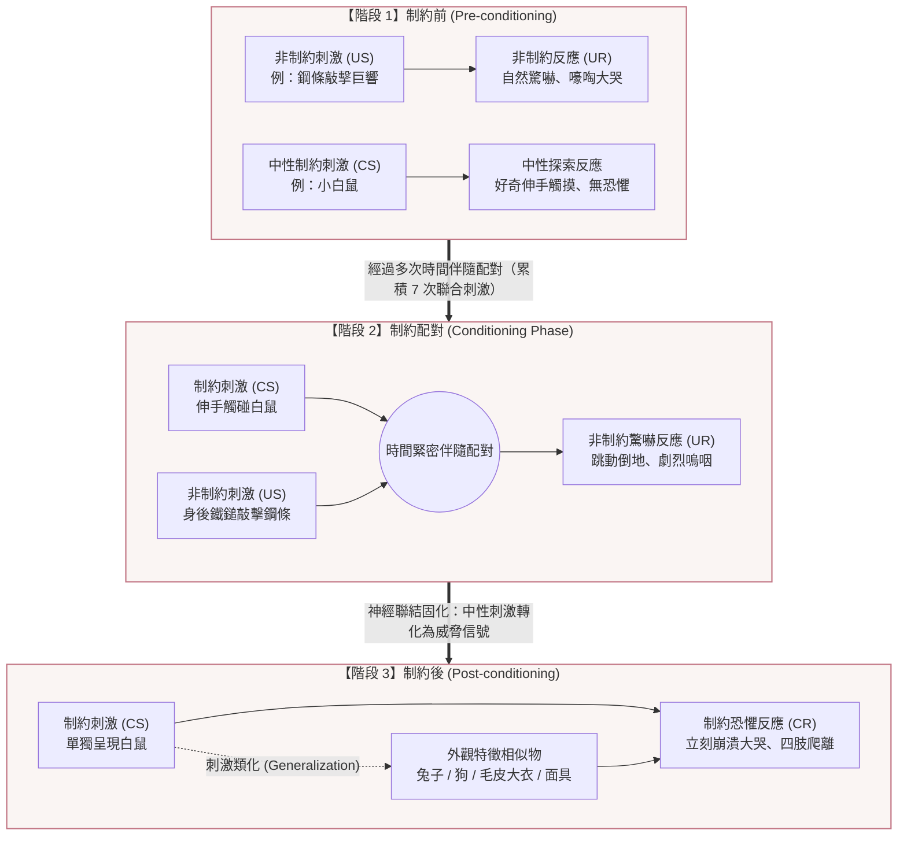

# 古典制約理論 (Classical Conditioning)

> [!info] 理論定義
> 古典制約（又稱巴夫洛夫制約）是一種聯結學習機制。當原本無法引發特定生理或情緒反應的中性刺激（制約刺激, CS），與能夠自然引發非自主生理反應的無條件刺激（非制約刺激, US）在時間上多次重複伴隨出現後，該中性刺激便能單獨誘發與原反應相似的反應（制約反應, CR）。

---

## 1. 核心模型架構 (Core Model)

---

## 2. 實證證據演進 (Empirical Evidence Timeline)

* **1920年**：[[watson-rayner-1920-conditioned-fear|Watson & Rayner (1920)]]
  * **突破性貢獻**：首度將動物生理學的巴夫洛夫制約機制推展至人類嬰兒的情緒歷程，證實僅需 7 次 CS-US 配對即可建立持續性的情緒恐懼。
  * **關鍵衍生**：發現了制約反應並非侷限於單一刺激，而是會自發擴散至特徵相似的物體，催生了 [[stimulus-generalization|刺激類化]] 理論。

---

## 3. 理論侷限與後續演變 (Limitations & Evolution)

> [!warning] 準備學習原則（Preparedness）的挑戰
> 古典行為主義假設「任何刺激皆可等同地成為制約刺激（Equipotentiality 原則）」。然而後續研究（如 Seligman, 1971; Öhman, 1992）指出，生物在演化上具有「預備學習（Prepared Learning）」傾向——生物體對蛇、蜘蛛等具生存威脅的刺激能極快速建立恐懼制約，但對木塊、布簾等無生命刺激則極難制約成功。這直接動搖了 Watson 當年的通用等能假設。
