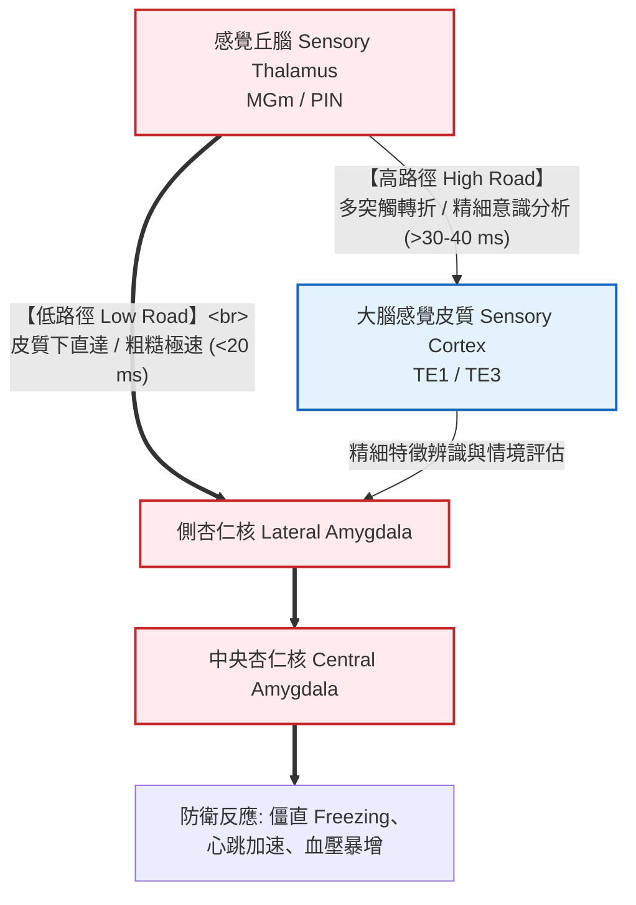

# 情緒雙路徑理論 (Dual-Route Theory of Emotion)

> [!info] 理論定義
> 情緒雙路徑理論由 Joseph LeDoux 於 1990 年代提出並在 2000 年系統總結。該理論主張大腦在處理威脅刺激（如引發恐懼的物體）時，存在兩條在速度、解析度與神經解剖上並行的神經路徑：「低路徑（Low Road）」負責演化上的生死極速避險，「高路徑（High Road）」負責認知上的精確特徵辨識。

---

## 1. 雙路徑神經迴路對比 (Low Road vs. High Road)

### 關鍵維度比較表

| 維度 | 低路徑 (Low Road) | 高路徑 (High Road) |
| :--- | :--- | :--- |
| **神經路徑** | 感覺器官 $\rightarrow$ 丘腦 $\rightarrow$ 側杏仁核 (LA) | 感覺器官 $\rightarrow$ 丘腦 $\rightarrow$ 感覺皮質 $\rightarrow$ 側杏仁核 (LA) |
| **傳導速度** | 極快（神經反應延遲 $< 20\text{ ms}$） | 較慢（延遲時間顯著拉長） |
| **訊號解析度** | 粗糙、單維、未經意識加工的原始刺激 | 精細、多維、複雜圖案與語意辨識 |
| **演化功能** | 生死存亡關頭的瞬間防禦（「寧可誤報，不可漏報」） | 驗證威脅真偽，抑制不必要的虛警反應 |
| **生活實例** | 在樹林草叢中瞥見彎曲條狀物，身體瞬間僵直跳開 | 走近定睛細看，意識到那只是一條生鏽的水管，隨即放鬆 |

---

## 2. 實證證據演進 (Empirical Evidence Timeline)

* **2000年**：[[ledoux-2000-emotion-circuits|LeDoux (2000)]]
  * **單元記錄 (Single-unit recordings)**：在大鼠側杏仁核（LA）記錄到對聲音 CS 的超短延遲放電（10~15 ms），比聽覺皮質的反應早出現數個毫秒，證實丘腦直達路徑在制約獲得中扮演先導角色。
  * **人類 fMRI 研究**（Morris et al., 1999）：在人類受試者身上呈現潛意識（閾下遮蔽）的恐懼面孔時，杏仁核活性顯著升高，且該活性直接與丘腦活動共變，證實人類大腦亦完整保留此條皮質下直達的低路徑。
