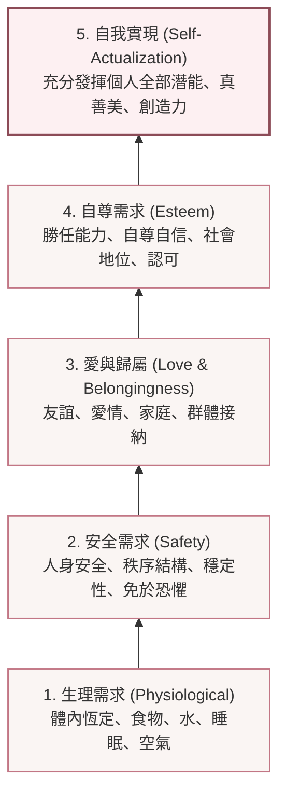

# 需求階層理論 (Hierarchy of Needs Theory)

> [!info] 理論定義
> 需求階層理論是由 Abraham Maslow 於 1943 年提出的人類動機架構。該理論主張人類行為是由五個具備內在階層關係的基本需求系統所驅動；這些需求依據「相對優勢性（Prepotency）」排列，當較低層級的匱乏需求得到相對滿足後，更高層級的成長需求才會顯現並支配個體的心理生活。

---

## 1. 五層階層結構 (The Five Levels)



```text
               ▲
              / \
             /   \      5. 自我實現需求 (Self-Actualization)
            /-----\        追求發揮個人全部潛能、真善美、創造力
           /       \    4. 自尊需求 (Esteem)
          /---------\      自我價值感、勝任能力、社會認可、聲譽
         /           \  3. 愛與歸屬需求 (Love & Belongingness)
        /-------------\    友誼、愛情、家庭、群體接納
       /               \2. 安全需求 (Safety)
      /-----------------\  人身安全、秩序結構、穩定性、免於恐懼
     /                   \1. 生理需求 (Physiological)
    /---------------------\ 體內恆定、食物、水、睡眠、空氣
```

---

## 2. 實證與理論特徵 (Empirical Characteristics)

* **奠基實證**：[[maslow-1943-human-motivation|Maslow (1943)]]
* **相對優勢性（Relative Prepotency）**：
  * 當一個人在極端饑荒時，所有思維、夢境與價值觀皆圍繞食物運轉，「人只靠麵包而活」。但一旦生理獲得保障，安全需求立即浮現接管行為動機。
* **滿足百分比漸進觀（不是全有全無）**：
  * 高階需求並非在低階 100% 滿足後才跳躍產生，而是以漸進比例湧現（如平均公民可能為：生理 85%、安全 70%、愛 50%、自尊 40%、自我實現 10%）。
* **階層反轉與例外**：
  * 天賦創作者在物質極度匱乏下仍全力創作；殉道者為社會理想犧牲生命。

---

## 3. 學術爭辯與批判 (Controversies)

> [!warning] 跨文化研究與實證挑戰
> 後續跨文化實證研究（如 Hofstede 文化維度研究、Wahba & Bridwell, 1976 元分析）指出：需求階層的先後順序帶有強烈西方個人主義色彩。在集體主義社會中，群體歸屬感與關係連結常優先於個人自尊與自我實現。詳見 [[hierarchy-universality-debate|需求階層普遍性爭辯]]。
