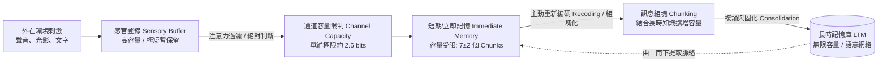

# 人類訊息處理理論 (Information Processing Theory)

> [!info] 理論定義
> 人類訊息處理理論將人類心智類比為一部精密、多階段的資訊通訊與計算系統。該理論主張外在物理刺激必須依序經過**感覺登錄（Sensory Input）**、**注意選擇與容量過濾（Filtering & Channel Capacity）**、**工作/短期記憶編碼（Working Memory / Chunking）**，最終固化至**長時記憶儲存（Long-term Storage）**。

---

## 1. 核心架構流程圖 (Information Flow)

---

## 2. 實證證據演進 (Empirical Evidence Timeline)

* **1956年**：[[miller-1956-magical-number-seven|Miller (1956)]]
  * **里程碑發現**：首次將資訊理論數學模型（Bits、通道容量）引入心理學，嚴格區分出「絕對判斷的資訊位元限制」與「立即記憶的組塊數量限制（$7 \pm 2$）」，奠定現代認知心理學的基石。

---

## 3. 理論瓶頸與後續演化

> [!important] 現代修正：從靜態儲存到動態工作記憶
> * 後續學者 Alan Baddeley (1974) 進一步將靜態的「短期記憶」升級為多組件的「工作記憶模型（Working Memory）」，包含中央執行系統（Central Executive）、語音迴路（Phonological Loop）與視覺空間素描板（Visuo-spatial Sketchpad）。
> * Nelson Cowan (2001) 則進一步修正純組塊容量為 $4 \pm 1$。詳見 [[chunking-capacity-cowan-debate|短期記憶容量爭端]]。
