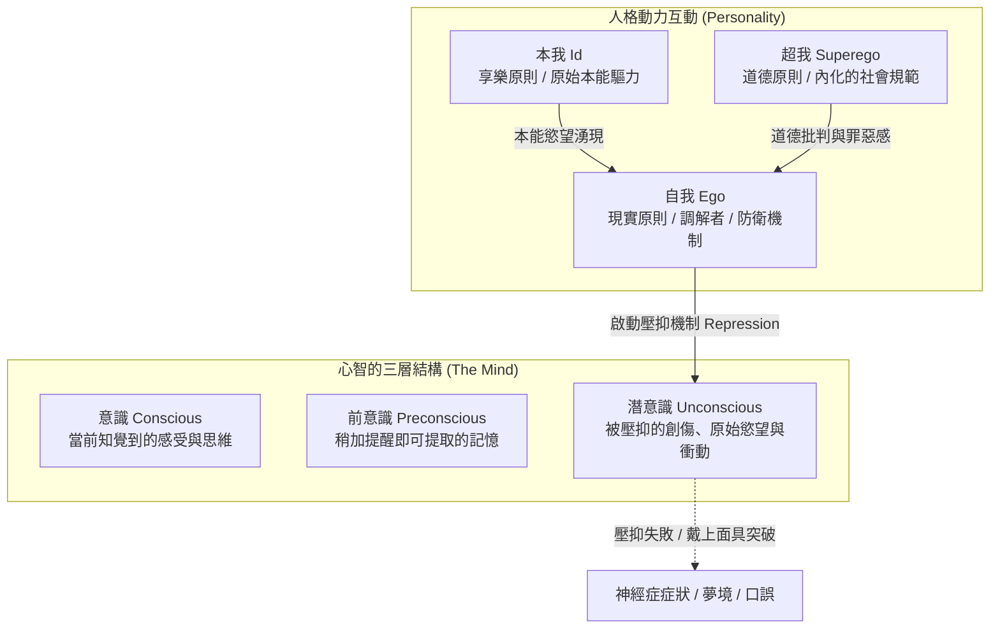

# 精神分析理論 (Psychoanalytic Theory)

> [!info] 理論定義
> 精神分析理論是由 Sigmund Freud 創立的心理動力學架構。該理論主張人類的心智運作是由內在相互抗衡的心理力量（驅力、願望、防衛與超我道德）所驅動；個體的外顯行為、性格特質及病理症狀，本質上皆是深層潛意識衝突與防衛機制妥協後的產物。

---

## 1. 核心模型架構 (Core Model)

---

## 2. 實證與臨床演進時間軸 (Timeline)

* **1910年**：[[freud-1910-psychoanalysis-origin|Freud (1910)]]
  * **關鍵主張**：總結自 1880 年代 Breuer 治療 Anna O. 以來的臨床洞察，確立「壓抑」為致病核心，提出幼兒性慾與伊底帕斯情結，並將自由聯想與夢的解析確立為精神分析標準技術。

---

## 3. 跨學派爭辯與理論交鋒

* **成因論戰**：[[watson-rayner-1920-conditioned-fear|Watson & Rayner (1920)]] 質疑本理論過度泛性論，證明環境中的制約反射即可產生持續性情緒障礙。
* **科學哲學檢驗**：Karl Popper 指出精神分析理論因為具備「事後諸葛式的無限解釋力」，缺乏可證偽性（Falsifiability）。
